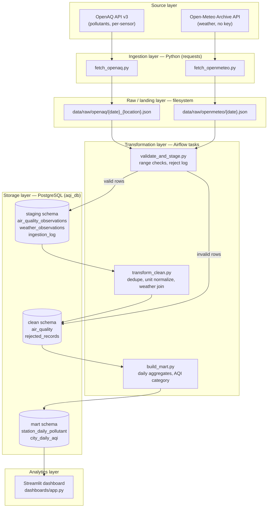
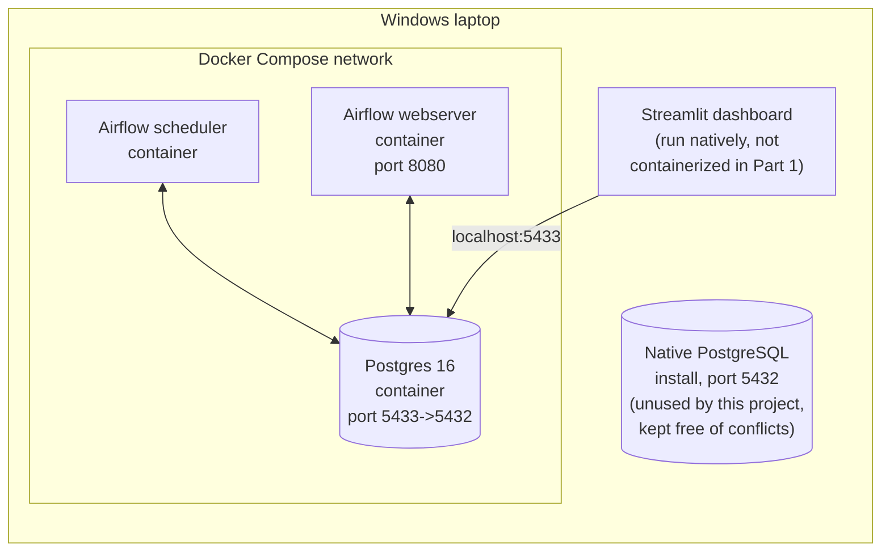

# Architecture — AQI Analysis & Prediction (Part 1)

## Pipeline flow

Orchestration: Apache Airflow (`LocalExecutor`), DAG `aqi_ingestion_pipeline`, schedule `@daily`.
Task dependency graph: `[fetch_openaq, fetch_openmeteo] >> validate_and_stage >> transform_clean >> build_mart`.

## Deployment view

Postgres and Airflow run in Docker (single `docker-compose.yml`, shared network) so the whole pipeline reproduces with one `docker compose up --build`. The container's Postgres port is published on **5433**, not 5432, because a native PostgreSQL install already occupies 5432 on this machine — internal Airflow↔Postgres traffic is unaffected since it happens over the Docker network by service name (`postgres:5432`). Docker was deliberately *not* used for Part 1's dashboard — only Part 2's FastAPI inference service is a Docker requirement per the assignment; Part 1's Streamlit app runs natively against the published Postgres port.

## Layer-by-layer summary

| Layer | Technology | What it does |
|---|---|---|
| Source | OpenAQ v3, Open-Meteo Archive API | External public data |
| Ingestion | Python `requests`, orchestrated by Airflow | Pulls raw JSON, no transformation |
| Raw/landing | Filesystem (`data/raw/`) | Immutable copy of each day's API response, one file per source per date |
| Staging | Postgres `staging` schema | Structured but unvalidated/unnormalized rows, plus a run-level ingestion log |
| Transformation | Python (pandas) inside Airflow tasks | Range validation, dedup, unit normalization, weather join |
| Storage (clean) | Postgres `clean` schema | Deduplicated, unit-normalized fact table + rejected-record log |
| Storage (mart/gold) | Postgres `mart` schema | Daily aggregates by station/pollutant and by city |
| Analytics | Streamlit | Reads directly from `mart` tables, 5 views (trend, category mix, pollutant contribution, city comparison, station detail) |
| MLOps (Part 2, out of scope here) | MLflow, FastAPI, Docker | Not implemented in Part 1 by design |
