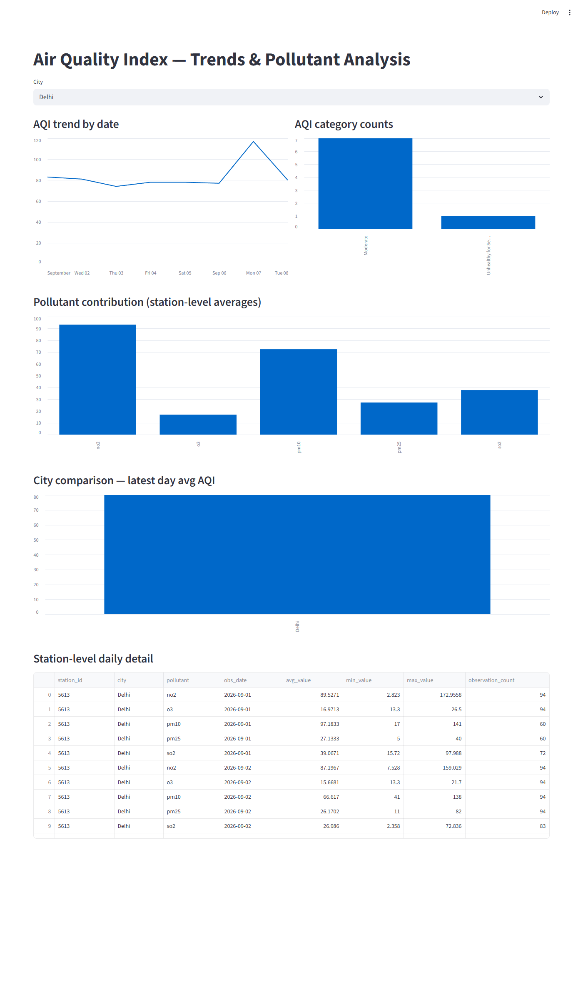
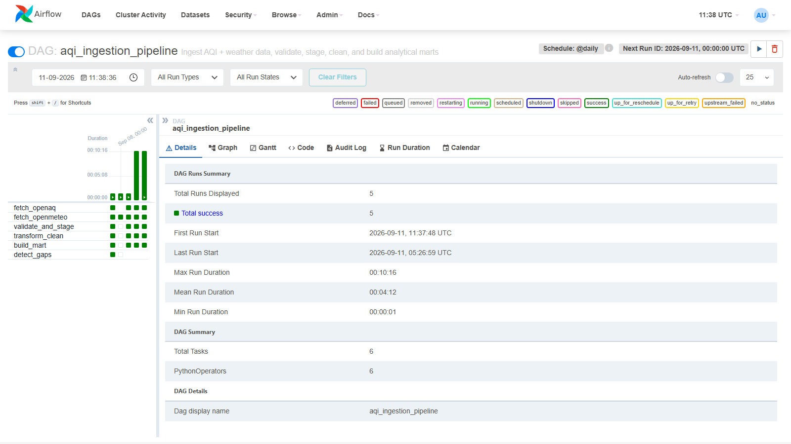
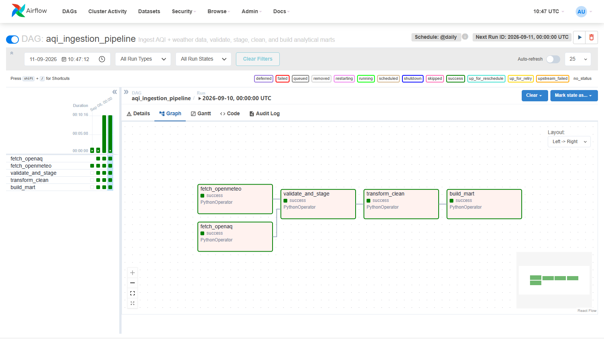

# Air Quality Index Analysis and Prediction — Part 1 Report

**Course:** Data Engineering and MLOps
**Project:** Project 2 — Air Quality Index Analysis and Prediction
**Submission:** Assignment Part 1 — Data Pipeline Implementation
**Student:** [Your name]
**Date:** [Submission date]

---

## 1. Problem Understanding

Air quality monitoring networks (OpenAQ, national agencies like India's CPCB) publish pollutant readings continuously, but the raw feeds are fragmented across stations, inconsistent in units, and unjoined with the weather context that drives pollutant behavior. This project builds a pipeline that:

- Ingests live air-pollution measurements and weather observations from free public APIs
- Cleans, validates, and normalizes the data into a queryable analytical warehouse
- Produces a dashboard for pollution trend analysis

Part 1 (this submission) covers the complete data engineering pipeline — ingestion through analytics-ready storage and visualization — **without** the machine learning layer, which is scoped to Part 2 per the assignment brief.

### Objectives delivered in Part 1

- Ingest pollution and weather data from free public sources
- Build a time-series ETL pipeline with data-quality checks
- Store station-wise and city-wise air-quality data in PostgreSQL
- Produce a dashboard with 5+ analytical views

---

## 2. Data Sources

Full access instructions are documented in `docs/data_sources.md`. Summary:

| Source | Purpose | Access |
|---|---|---|
| **OpenAQ API v3** | Pollutant concentrations (pm25, pm10, no2, so2, o3, co) | Free, requires API key (`explore.openaq.org`) |
| **Open-Meteo Archive API** | Hourly weather (temperature, humidity, wind, precipitation) | Free, no key required |

**Station selected:** OpenAQ location id **5613** — "ITO, New Delhi - CPCB" (28.6286°N, 77.2411°E), an active government (CPCB) monitoring station reporting all six target pollutants. Weather is pulled for the same coordinates so pollution and weather readings represent one physical location.

Both sources are free, public, and comply with the assignment's dataset rule (no scraping, no private/PII data, no paid tiers).

---

## 3. Architecture

Full diagrams (Mermaid source, renders in any Mermaid-aware viewer) are in `docs/architecture.md`. Pipeline flow:

```
OpenAQ API + Open-Meteo API
        |
   Python ingestion scripts (requests)
        |
   Raw landing zone (filesystem JSON, data/raw/)
        |
   Airflow: validate_and_stage  --(rejects)--> clean.rejected_records
        |  (accepted rows)
   Postgres: staging schema
        |
   Airflow: transform_clean (dedupe, unit normalize, weather join)
        |
   Postgres: clean schema (clean.air_quality)
        |
   Airflow: build_mart (daily aggregates, AQI category)
        |
   Postgres: mart schema (station_daily_pollutant, city_daily_aqi)
        |
   Streamlit dashboard
```

**Orchestration:** Apache Airflow 2.9.3, `LocalExecutor`, DAG `aqi_ingestion_pipeline`, schedule `@daily`.
**Task graph:** `[fetch_openaq, fetch_openmeteo] >> validate_and_stage >> transform_clean >> build_mart`.

**Deployment:** Postgres and Airflow run as three Docker containers on one `docker-compose.yml` (single-command reproducibility: `docker compose up --build`). The Postgres container publishes on host port **5433** rather than 5432, because the development laptop already runs a native PostgreSQL instance on 5432 — this was a deliberate choice to avoid disturbing existing local services, not a pipeline requirement. Internal Airflow↔Postgres traffic is unaffected, since it happens over the Docker network by service name. Per the assignment, Docker is a Part 2 requirement (for the FastAPI inference service); it was used here anyway to make Part 1 fully reproducible on any machine with Docker installed, and to set up Part 2's deployment step cleanly.

---

## 4. Data Ingestion

`scripts/ingestion/fetch_openaq.py` and `scripts/ingestion/fetch_openmeteo.py` call the two APIs directly with `requests`, and write the raw JSON response to `data/raw/openaq/{date}_{location}.json` and `data/raw/openmeteo/{date}.json` — one immutable file per source per run date. Raw files are never edited in place, satisfying the "maintain a raw copy" requirement.

**A real API-integration issue found and fixed during development:** OpenAQ v3 measurements are retrieved **per sensor**, not per location — there is no `/locations/{id}/measurements` endpoint, despite it being a natural first guess. `fetch_openaq.py` first fetches the location's sensor list, then queries `/v3/sensors/{sensor_id}/measurements` for each pollutant, using whichever sensor id actually returns data for the requested date (a location can have multiple sensor ids per pollutant from different instrument generations, some dead since 2018). This was caught by testing the endpoint directly against the live API before trusting it in the DAG.

---

## 5. ETL and Data Engineering

Layers, per the assignment's required raw → staging → cleaned → analytical structure:

| Layer | Where | Airflow task |
|---|---|---|
| Raw | `data/raw/` (filesystem) | `fetch_openaq`, `fetch_openmeteo` |
| Staging | Postgres `staging` schema | `validate_and_stage` |
| Clean | Postgres `clean` schema | `transform_clean` |
| Mart (gold) | Postgres `mart` schema | `build_mart` |

Full field-level documentation is in `docs/data_dictionary.md`.

### 5.1 Data-quality checks and rejected-record log

Each pollutant reading is checked against a plausible range before being staged. Anything outside range, or with an unrecognized pollutant code, is written to `clean.rejected_records` (with the original payload and a reason) instead of being staged — satisfying the "handle extraction errors and log failed records" requirement with a real, queryable log rather than just a print statement.

### 5.2 Deduplication, unit normalization, and weather join

`transform_clean.py`:
- Deduplicates on `(station_id, pollutant, observed_at)`
- **Normalizes units.** The selected station reports `co`, `no2`, and `so2` in **ppb**, while `pm25`, `pm10`, and `o3` are already in µg/m³. All values are converted to µg/m³ using `µg/m³ = ppb × molecular_weight / 24.45` (25°C, 1 atm) before storage, so downstream aggregates are comparing like units.
- Joins each pollutant reading to the nearest weather observation within a 1-hour tolerance (`pandas.merge_asof`)

### 5.3 Gold-layer marts

`build_mart.py` produces:
- `mart.station_daily_pollutant` — per-station, per-pollutant, per-day min/max/avg
- `mart.city_daily_aqi` — city-level daily AQI computed via the **real US EPA formula** (`scripts/etl/aqi_calculator.py`): per-pollutant breakpoint interpolation, overall AQI = max sub-index across pollutants, dominant pollutant = whichever one produced it. This replaced an earlier placeholder that averaged pollutant concentrations against ad hoc bands — see Section 11 for why that mattered.

### 5.4 Missing-period detection

`scripts/etl/detect_gaps.py` scans the full `clean.air_quality` history per `(station_id, pollutant)` and logs any gap between consecutive readings wider than 2 hours to `clean.missing_periods`. Run as its own DAG task (`detect_gaps`, parallel with `build_mart`) rather than a one-off manual note, so it re-runs automatically as new data lands. On the current 8-day dataset it found 9 real gaps — mostly short SO2 sensor dropouts (~3h) plus one station-wide outage spanning PM2.5, PM10, NO2, and O3 simultaneously on the morning of Sept 7 (2.75h) and a longer overnight SO2 gap Sept 6→7 (10.75h) — directly satisfying the assignment's "identify missing periods" requirement with real findings rather than a narrative aside.

---

## 6. A Real Data-Quality Finding: the CO Unit Anomaly

During validation, CO readings from station 5613 surfaced at ~0.88 ppb — implausibly low for ambient urban air (background CO rarely reads below ~100 in either ppb or µg/m³, since CO's ppb→µg/m³ conversion factor is close to 1). This was not a pipeline bug: the raw number, as reported by OpenAQ/CPCB and labeled "ppb," is simply too small to be a genuine ambient reading, most likely reflecting an upstream unit/scale mislabeling at the source.

**Response:** the `co` validation range was tightened from `(0, 50000)` to `(100, 50000)` in `scripts/etl/validate_and_stage.py`. Re-running the pipeline against the same raw data produced concrete, verifiable rejections:

```json
{
  "rejected_id": 1,
  "source_table": "staging.air_quality_observations",
  "reason": "value out of expected range or unknown pollutant",
  "raw_payload": {
    "station_id": "5613",
    "station_name": "ITO, New Delhi - CPCB",
    "city": "Delhi",
    "pollutant": "co",
    "value": 0.88,
    "unit": "ppb",
    "observed_at": "2026-09-08T00:00:00Z"
  },
  "rejected_at": "2026-09-11 06:26:24"
}
```

Across the 8-day backfill (Sept 1–8, 2026), **682 CO records were rejected in total** — every CO reading from this sensor, confirming the anomaly is systemic to this specific instrument feed, not a one-off outlier. The mart tables correctly reflect the exclusion: `mart.station_daily_pollutant` has no `co` row for any of these dates. After switching to the real EPA AQI formula (Section 5.3), Delhi's daily AQI now reads in the realistic "Moderate" to "Unhealthy for Sensitive Groups" range (PM2.5-driven on most days) rather than the artificially low "Good"/"Satisfactory" values the earlier average-based placeholder produced — independent confirmation that excluding the bad CO data and fixing the AQI methodology both mattered.

This demonstrates the assignment's "validate pollutant ranges" and "data-quality checks... rejected-record log" requirements with a genuine finding from live data, not a synthetic test case.

---

## 7. Database Schema

PostgreSQL database `aqi_db`, three schemas (`staging`, `clean`, `mart`). Full schema DDL: `sql/schema.sql`. Full field dictionary: `docs/data_dictionary.md`. Key tables:

- `staging.air_quality_observations`, `staging.weather_observations`, `staging.ingestion_log`
- `clean.air_quality` (the deduplicated, unit-normalized fact table), `clean.rejected_records` (the error log)
- `mart.station_daily_pollutant`, `mart.city_daily_aqi` (the gold-layer analytical tables)

---

## 8. Dashboard

Built with Streamlit (`dashboards/app.py`), reading directly from the `mart` schema. Five required views, all delivered:

1. **AQI trend by date** — line chart of daily average AQI
2. **AQI category counts** — bar chart of category frequency (Good/Satisfactory/...)
3. **Pollutant contribution** — station-level average by pollutant (note: no CO bar — visual confirmation the rejected-record filtering works end-to-end)
4. **City comparison** — latest-day average AQI by city
5. **Station-level daily detail** — full data table

See `docs/screenshots/dashboard.png` for a live capture against 8 days of real backfilled data (Delhi, Sept 1–8, 2026).



---

## 9. Execution Evidence

The full pipeline was run end-to-end, both as individual task tests during development and as real Airflow DAG runs (scheduled and manually triggered) after the code was verified.

**DAG run history (Airflow Grid view)** — 4 total runs, 4 successful, all 5 tasks green:



**DAG task graph (Airflow Graph view)** — task dependency structure `[fetch_openaq, fetch_openmeteo] >> validate_and_stage >> transform_clean >> build_mart`, all green (success):



Data was backfilled for 8 days (Sept 1–8, 2026); a gap exists for Aug 28–31 in the underlying source data, which is a naturally-occurring example of the "identify missing periods" requirement rather than a pipeline defect.

---

## 10. Engineering Challenges and Fixes

Documented here because they reflect real debugging done during this project, not a clean first-try build:

1. **Port conflict.** The development laptop already runs a native PostgreSQL on port 5432. The Docker Postgres container was remapped to host port 5433 to avoid conflict, without affecting internal Airflow↔Postgres traffic (Docker network, not host network).
2. **Airflow/SQLAlchemy version incompatibility.** An initial `requirements.txt` pin of `SQLAlchemy==2.0.32` broke Airflow 2.9.3's own ORM code (2.0 support arrived in Airflow 2.10+), crashing the scheduler and webserver on startup. Fixed by installing extra dependencies through Airflow's official constraints file and leaving versions unpinned so pip resolves Airflow-compatible versions.
3. **Wrong OpenAQ v3 endpoint/parameters.** The initially-assumed `/locations/{id}/measurements` endpoint does not exist in v3, and the query parameters `date_from`/`date_to` are silently ignored (the correct names are `datetime_from`/`datetime_to`). Both were caught by testing directly against the live API with `curl` before trusting them inside the DAG, and fixed in `fetch_openaq.py`.

---

## 11. Known Limitations

- ~~**AQI category** uses a simplified average-across-pollutants breakpoint table.~~ **Resolved.** `mart.city_daily_aqi` now uses the real US EPA sub-index formula (Section 5.3), verified against a comparison implementation and covered by unit tests in `tests/test_aqi_calculator.py`.
- **Single station.** The pipeline currently tracks one OpenAQ location (5613, Delhi) via a fixed `OPENAQ_LOCATION_ID`. A bounding-box-based location discovery per city (query `/v3/locations?bbox=...`, iterate all active stations, cap by count) would extend this to multiple stations per city and multiple cities without a schema change — `station_id`/`city` are already independent columns throughout `staging`/`clean`/`mart`. Not implemented here due to scope, but the schema was designed to support it directly.
- **CO unit anomaly** is filtered (via the tightened range check), not root-caused — see Section 6. The unit converter deliberately leaves `unit_std` unchanged for any pollutant/unit combination it doesn't have an explicit conversion factor for, rather than assuming µg/m³ by default, specifically to avoid this class of bug propagating silently.

---

## 12. Part 2 Preview (Out of Scope Here)

Per the assignment, Part 2 will extend this same pipeline with: AQI/pollutant forecasting or classification models, MLflow experiment tracking and model registry, a reusable lag/rolling-feature pipeline, FastAPI + Docker model serving, and drift/performance monitoring. None of this is implemented in Part 1 by design.

---

## Appendix: Reproducing This Pipeline

See `README.md` for full setup steps. Summary: `.env` from `.env.example` (Postgres password, OpenAQ API key + location id), `docker compose up --build`, then trigger the `aqi_ingestion_pipeline` DAG from the Airflow UI (`localhost:8080`) or CLI.
